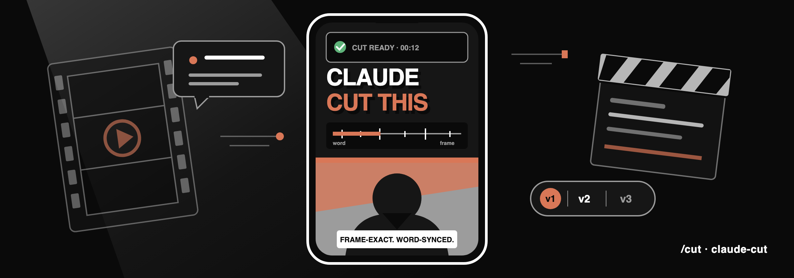

# /cut

<p align="center">
  
</p>

**Let Claude edit your talking-head video.**

One prompt, one skill: a word-synced animation zone above your face, cut into
hook versions, rendered to finished MP4s.

Claude Code (recommended, auto-updates via the marketplace):
```
/plugin marketplace add epictaste/claude-cut
/plugin install cut@epictaste
```

Codex, Cursor, Copilot, Gemini CLI, or any of the 50+
[Agent Skills](https://agentskills.io) hosts:
```bash
npx skills add epictaste/claude-cut -g
```
(`-g` installs globally for your user. Drop it to scope the install to the
current project.)

---

You shot a good take. What is missing is the half hour of editing on top: the
graphics that make the top half worth watching, a second version with the other
hook you recorded, and every cut landing on the right word.

`/cut` does that part. You hand it a vertical video, it measures how much room
there is above your face, transcribes the audio down to the individual word,
cuts the versions frame by frame, builds the animation zone as a real Remotion
project, and renders the finished files.

```
/cut ~/Movies/take.mp4 I shot three hooks back to back, make three versions
```

The thing that makes this work is one rule: **the video is the truth.** Every
scene change sits on a word that was actually spoken, looked up from the
transcript, never on a time somebody estimated. Animation that lands on the word
reads as edited. Animation that lands near the word reads as broken.

## What people use it for

**Turn one take into several hooks.** Record three openers back to back, get
three finished videos that share the same body and differ only in the first few
seconds. Post one, keep the others, compare.

**Fill the top half.** A vertical talking head leaves the upper part of the
frame doing nothing. `/cut` fills it with a terminal typing out the command you
are describing, a card with the number you just said, a check mark landing on
the word "done".

**Put numbers on screen.** The claim you make out loud is more convincing when
the figure is sitting next to your head while you say it. The skill will not
invent one: it only shows what you give it.

**Keep the secrets out.** A screen recording of a prompt, a key, a private path
goes under a pixel mosaic with only the first line readable.

**Edit in the language you speak.** Deepgram's `nova-3` with `language=multi`
handles English, German, and clips that mix the two, so the word lookup works
without configuring a language.

## How it works

1. **Preflight.** `setup.py` checks ffmpeg, ffprobe, node, and your Deepgram
   key. On macOS it installs the missing binaries with brew, elsewhere it prints
   the exact commands.
2. **Words.** The audio is extracted and sent to Deepgram, once. The result
   becomes `words.json`: every word with the frame it is spoken on, grouped into
   the parts of the video, relative to each part. The raw response is kept, so
   re-splitting into different parts later costs nothing and uploads nothing.
3. **Zone.** `zone.py` scans several frames for the top edge of your burned-in
   subtitle box and puts the zone 23 px above it. No subtitles means it falls
   back to half the frame.
4. **Structure.** Claude asks one bundled set of questions: which hook versions,
   a text hook poster or a word animation, dark zone with a hard edge or
   floating elements.
5. **Cuts.** `cut.py` trims and concatenates with ffmpeg, then verifies the
   frame count of every version with ffprobe. A version that is one frame off is
   rejected rather than built on. Every version gets its own layout, so hooks of
   different lengths are the normal case and not a special one.
6. **Scaffold.** The Remotion template is copied next to your video as
   `cut-<slug>/`, with its own `public/` so a render never copies a large shared
   asset folder.
7. **Parts.** One sub-agent per part of the video, briefed with `PART_BRIEF.md`,
   each rendering stills of its own work and fixing clipped text or a scene that
   stands still before reporting back.
8. **Render and composite.** Remotion renders the zone, ffmpeg lays it over the
   cut and mixes six synthesized UI sounds about 10 dB under your voice. If the
   zone and the cut do not have exactly the same frame count, the build stops
   instead of quietly trimming to the shorter one.
9. **Check.** Seven frames of the result are stacked into a contact sheet.
   Claude reads it and answers three questions: does the edge sit right, does
   the graphic match the sentence, is the subtitle box free.
10. **Deliver.** It prints the paths. That is the end. It does not post, upload,
    or message anyone.

## Requirements

| What | Why | Cost |
|------|-----|------|
| `ffmpeg` + `ffprobe` | cutting, measuring, compositing, sound synthesis | free |
| Node 20+ | Remotion renders the animation zone | free |
| Python 3.10+ | the scripts, stdlib only | free |
| A constant 30 fps take | every frame number in the skill assumes it | free, and the scripts print the `ffmpeg` command to convert |
| [Deepgram API key](https://console.deepgram.com) | word-level timestamps | free credit on signup |

Put the key in `~/.config/cut/.env`:

```
DEEPGRAM_API_KEY=your-key-here
```

If you already use [`watch`](https://github.com/epictaste/claude-eyes), the key
in `~/.config/watch/.env` is picked up automatically and there is nothing to
configure.

## The look

Neutral and hard edged, built to stay readable on a phone at arm's length:

- Inter Black with a hard drop shadow, no glow, no blur, no gradient
- Black, white, gray, and exactly one accent color, terracotta by default, one
  line in `blocks.tsx` to change
- Green only for check marks inside mock interfaces
- Mock interfaces instead of text chips: a terminal, a chat window, a file card
- A core graphic at most 760 px wide, vertically centered, with the top 180 px
  left free for the platform header

And a short list of things it will not do, because they are the usual ways this
kind of video goes wrong:

- No headline that repeats the sentence you are speaking
- No emphasis word that is not a number
- No fade, no spring, nothing floating
- No scene that stands there finished while you keep talking

## Usage

```
/cut ~/Movies/take.mp4
/cut ~/Movies/take.mp4 animate the top half, terracotta accent
/cut take.mp4 three hooks in the first 20 seconds, one version each
/cut take.mp4 no burned-in subtitles, use the top half
```

## Structure

```
.
├── skills/cut/                 # self-contained skill, copied as a unit by every installer
│   ├── SKILL.md                # the skill contract and the design rules
│   ├── PART_BRIEF.md           # briefing for a sub-agent building one part
│   ├── scripts/
│   │   ├── setup.py            # preflight and installer
│   │   ├── words.py            # Deepgram word timings to per-part frames
│   │   ├── zone.py             # subtitle-box measurement, no image library
│   │   ├── cut.py              # frame-exact cuts, verified with ffprobe
│   │   ├── sfx.py              # six UI sounds synthesized with ffmpeg
│   │   ├── build.py            # render, composite, contact sheet
│   │   └── config.py           # shared config and media helpers
│   └── template/               # the Remotion project that gets scaffolded
│       └── src/{timing,blocks,Top,Root,sfx}.* + parts/
├── hooks/                      # SessionStart status hook (Claude Code)
├── .claude-plugin/             # plugin.json + marketplace.json
├── .codex-plugin/              # Codex and Agent Skills manifest
├── tests/                      # pytest, ffmpeg-synthesized clips, no network
└── .github/workflows/ci.yml    # pytest plus a template typecheck
```

## Develop

```bash
# Tests (ffmpeg required for the media tests)
python3 -m pytest -q

# Template typecheck
cd skills/cut/template && npm ci && npx tsc --noEmit

# See the look without a video
cd skills/cut/template && npx remotion still Top-V1 /tmp/cut-still.png --frame=10
```

See [CHANGELOG.md](CHANGELOG.md) for version history and
[SECURITY.md](SECURITY.md) for what leaves your machine.

## Open source

MIT license.

Built on [Remotion](https://remotion.dev), `ffmpeg`, and
[Deepgram](https://deepgram.com). Companion to
[claude-eyes](https://github.com/epictaste/claude-eyes), which gives Claude a
video input and shares the same config file.

Maintained by Georg Kinzel. More on AI workflows at
[georgkinzel.de](https://georgkinzel.de).

---

[github.com/epictaste/claude-cut](https://github.com/epictaste/claude-cut) · [LICENSE](LICENSE)
